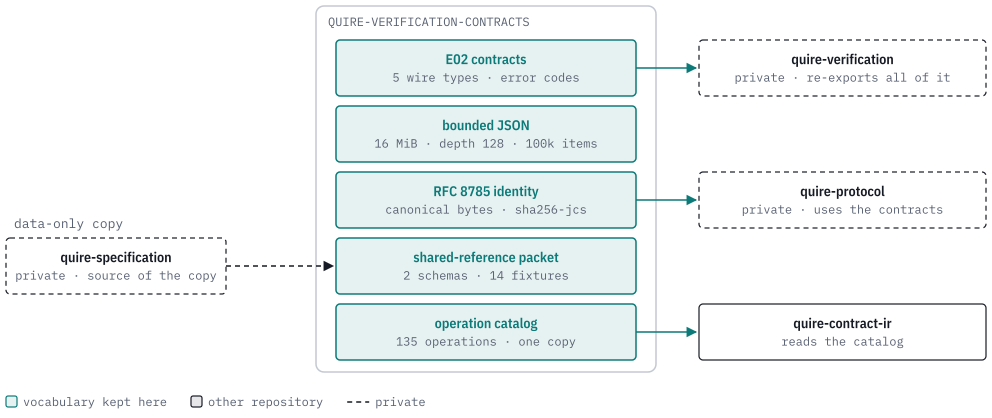
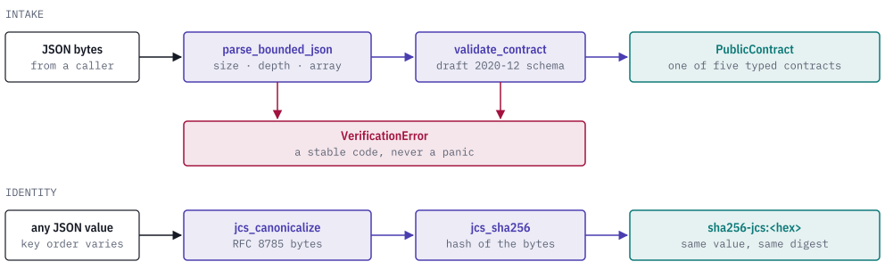

# quire-verification-contracts

[](https://discord.gg/k8DVhuYBR2)

quire-verification-contracts is a Rust crate and set of JSON Schemas that
define the five public verification contracts (technique definitions, tool
capabilities, selection policies, verification plans and technique results).
It also provides their stable error codes, RFC 8785 canonical JSON with a
digest built on it, and a JSON reader with fixed limits on size, nesting and
array length.

Other Quire repositories use it as the single definition of what a verification
record looks like, what counts as the same record, and how much input is
accepted. Its functions are total and do no I/O, so a bad input returns an
error code and does not panic.

<picture>
  <source media="(prefers-color-scheme: dark)" srcset="docs/images/hero-dark.svg">
  
</picture>

> **Status: public prerelease.** The crate is version 0.1.0 and is not
> published to a registry. The contract schema is a draft (`e02-draft-2`), so
> expect breaking changes.

## Overview

Reading JSON, checking it against a contract, and comparing records by identity
are three separate steps, and each one fails with a stable code.

<picture>
  <source media="(prefers-color-scheme: dark)" srcset="docs/images/intake-dark.svg">
  
</picture>

## Example

These calls come from `tests/integration.rs`, which the test suite runs. Two
objects with the same fields in a different order are the same record, and
their digest is the same:

```rust
use quire_verification_contracts::{jcs_equal, jcs_sha256};
use serde_json::json;

let left = json!({"b": 1, "a": 2});
let right = json!({"a": 2, "b": 1});
assert!(jcs_equal(&left, &right).expect("both values are in the JCS domain"));

let digest = jcs_sha256(&json!({"kind": "example"})).expect("value canonicalizes");
assert!(digest.starts_with("sha256-jcs:"));
```

An unknown contract kind is refused with a code a caller can match on. `minimal_tool_capability()` is the small valid
`ToolCapability` record defined at the top of the test file:

```rust
let mut value = minimal_tool_capability();
value["kind"] = json!("NotAContract");
let error = validate_contract(value).expect_err("unknown kind must be rejected");
assert_eq!(error.code(), VerificationErrorCode::SchemaViolation);
```

A document over the limits is refused before it is processed
(`oversized_json_document_is_rejected` in the same file):

```rust
use quire_verification_contracts::{MAX_JSON_BYTES, VerificationErrorCode, parse_bounded_json};

let oversized = vec![b'a'; MAX_JSON_BYTES + 1];
let error = parse_bounded_json(&oversized).expect_err("oversized input must be rejected");
assert_eq!(error.code(), VerificationErrorCode::JsonDocumentTooLarge);
```

The unmodified record validates into `PublicContract::ToolCapability`
(`valid_tool_capability_round_trips_through_validate_contract`).

## Reference

### Public API

| Item | What it does |
| --- | --- |
| `parse_bounded_json(bytes)` | Parse one JSON document, refusing it past the size, depth and array limits. |
| `validate_resource_envelope(value)` | Check the depth and array limits on a value already parsed, with an iterative walk. |
| `validate_contract(value)` | Validate against the draft 2020-12 schema and decode into `PublicContract`, one of the five contracts. |
| `validate_schema_definition(name, value)` | Validate against one named definition in the same schema; an unknown name is `unknown_schema_definition`. |
| `validate_plan_value(value)`, `validate_plan_graph(plan)` | Check a verification plan: duplicate ids, missing dependencies and cycles. |
| `jcs_canonicalize(value)` | The RFC 8785 bytes of any `serde::Serialize` value. |
| `jcs_equal(left, right)` | Whether two values have the same canonical bytes. |
| `jcs_sha256(value)` | `sha256-jcs:` followed by the SHA-256 of the canonical bytes. |
| `contract_version()`, `input_kinds()` | The schema's version string (`quire-verification/e02-draft-2`) and its five input kinds: state, relational, trace, fault, manual. |
| `VerificationErrorCode`, `VerificationError` | Stable snake_case codes (`as_str`, `from_code`, `all`) plus optional key/value context. |
| `wire` | Rust types generated from the schema at build time. |
| `shared_reference` | The shared-reference packet: `validate_shared_reference_v1` / `_v2`, generated `wire_v1` / `wire_v2` types and the fourteen `fixtures`. |
| `operation_catalog` | The checked-operation catalog bytes, version and SHA-256. |

### Limits

| Constant | Value | Error when exceeded |
| --- | --- | --- |
| `MAX_JSON_BYTES` | 16 MiB | `json_document_too_large` |
| `MAX_JSON_DEPTH` | 128 nested arrays and objects | `json_nesting_too_deep` |
| `MAX_ARRAY_ITEMS` | 100,000 per array | `json_array_too_large` |

### Data files

| File | What it is |
| --- | --- |
| `contracts/e02-draft-2.schema.json` | The authoritative definition of the five public contracts. The build generates the `wire` types from it and `validate_contract` compiles it at runtime. |
| `contracts/shared-reference-1-draft.schema.json`, `contracts/shared-reference-2-draft/schema.json`, `fixtures/shared-reference-2-draft/` | The shared-reference packet: two schemas and fourteen fixtures, a data-only copy of what private `quire-specification` defines. It is temporary and is deleted here once its source has a public home. |
| `contracts/checked-operation-catalog-v1.json` | The closed `quire.checked-operation-catalog/v1` vocabulary: 135 operations with their operand families, result forms and constraints. This crate is its only home. |

The catalog is published as raw bytes. The reader that decides what the catalog
admits lives in `quire-contract-ir`, so a second parse here would define the
vocabulary twice. See
[`contracts/README.md`](contracts/README.md) for the packet's scope and expiry,
and for the schema definitions that only private `quire-verification` uses.

## The Quire ecosystem

<picture>
  <source media="(prefers-color-scheme: dark)" srcset="docs/images/ecosystem-dark.svg">
  
</picture>

This crate is a foundation. It depends on no other Quire repository (its
dependencies are `serde`, `serde_json`, `serde_json_canonicalizer`, `sha2`,
`jsonschema`, `thiserror` and the build-time code generator `typify`). The
private `quire-verification` depends on it and re-exports it, `quire-protocol`
(private) depends on it directly,
[quire-contract-ir](https://github.com/agent-ix/quire-contract-ir) reads the
operation catalog from it, and
[quire-contract-codegen](https://github.com/agent-ix/quire-contract-codegen)
and quire-specification (private) depend on it too.

## Building and testing

The toolchain is pinned in `rust-toolchain.toml` (Rust 1.98.1, edition 2024).

```bash
make test        # cargo test
make ci          # fmt-check, clippy -D warnings, tests, cargo-deny, unsafe-comment audit, docs
```

The tests are `tests/integration.rs` (contracts, limits, JCS, error codes) and
`tests/shared_reference.rs` (the packet's schemas and fixtures).

## Contributing

Every contribution needs a signed Contributor License Agreement; the CLA bot
walks you through it on your first pull request. See
[CONTRIBUTING.md](CONTRIBUTING.md) and [CLA.md](CLA.md), or ask on
[Discord](https://discord.gg/k8DVhuYBR2).

## License

Licensed under the GNU Affero General Public License, version 3 or later
([LICENSE](LICENSE)).
